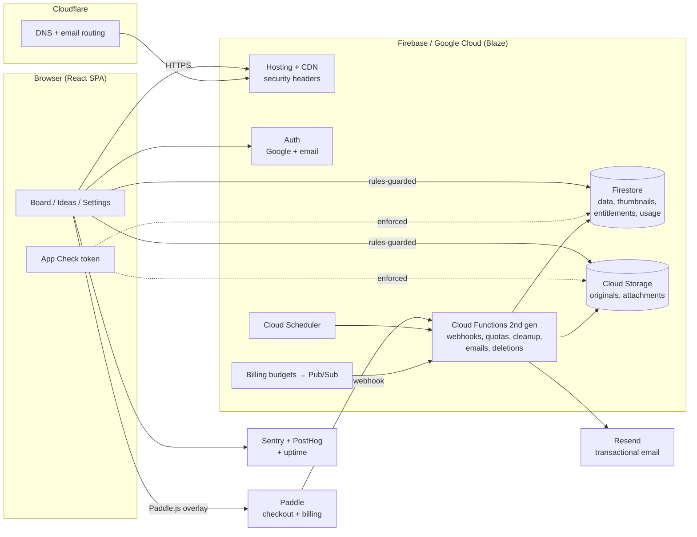
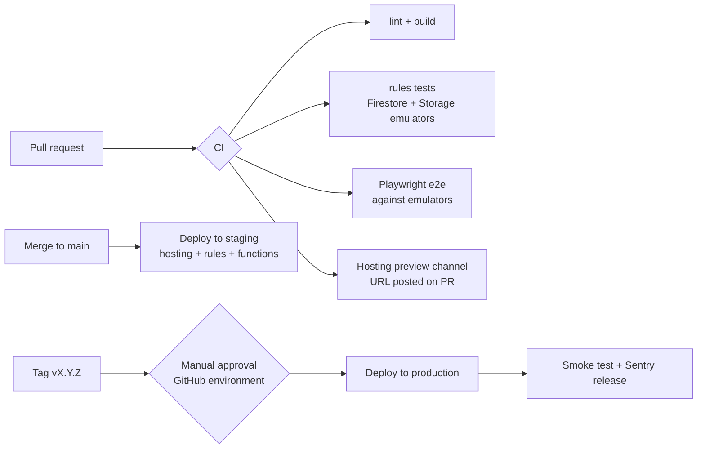

# KanbanPro — Solo Startup Plan

> A complete operating plan for taking KanbanPro from a working app to a profitable one-person SaaS: product positioning, pricing, budget, architecture, cloud and deployment, server-side operations, security and distribution.
>
> **Status of the product as of 25 Sep 2026:** Kanban board + table view, and Ideas (infinite PureRef-style canvases with embeds, full-quality originals and email-based sharing). React 19 + Vite + Tailwind 4 on Firebase (Auth + Firestore). Firestore rules have 63 passing emulator tests; the browser suite passes 21/21.
>
> Prices marked **✓** were checked against the vendor's page or current comparisons on the date above. Prices marked **≈** are estimates — confirm them on the vendor's pricing page before you commit money. Sources are listed at the end.

---

## Table of contents

1. [The plan on one page](#1-the-plan-on-one-page)
2. [Product and positioning](#2-product-and-positioning)
3. [Business model and pricing](#3-business-model-and-pricing)
4. [Budget and financial plan](#4-budget-and-financial-plan)
5. [Company, legal and payments setup](#5-company-legal-and-payments-setup)
6. [Software architecture](#6-software-architecture)
7. [Cloud and deployment system](#7-cloud-and-deployment-system)
8. [Server-side management and operations](#8-server-side-management-and-operations)
9. [Security checkup and hardening plan](#9-security-checkup-and-hardening-plan)
10. [Distribution and go-to-market](#10-distribution-and-go-to-market)
11. [Roadmap: first 12 months](#11-roadmap-first-12-months)
12. [Running it solo: cadence, tools and KPIs](#12-running-it-solo-cadence-tools-and-kpis)
13. [Risks and mitigations](#13-risks-and-mitigations)
14. [Appendix: cost formulas, checklists, config samples](#14-appendix)

---

## 1. The plan on one page

| Area | Decision |
|---|---|
| **Who it's for** | Visual creatives who plan work *and* collect references: freelance designers, illustrators, concept/game artists, and video creators. Secondary: small creative studios (2–10 people). |
| **Core promise** | "Your task board and your reference wall in one place — paste anything, share it with your team." |
| **Wedge feature** | Ideas: a browser-based PureRef with light thumbnails, full-quality originals on click, and video embeds. It's collaborative, which PureRef isn't. |
| **Pricing** | Free → **Pro $8/mo or $72/yr** → **Studio $10/seat/mo** (minimum 3 seats). Undercuts Milanote ($9.99/mo annual, $12.50 monthly ✓). |
| **Payments** | Paddle as Merchant of Record: 5% + 50¢ ✓, and it handles global sales tax/VAT for you. |
| **Hosting** | Firebase Hosting + Auth + Firestore + Cloud Storage + Cloud Functions on the Blaze plan. Cloudflare for DNS and email routing. |
| **Monthly running cost** | ~$5–25 before launch; **~$20–45 at 1,000 users**; ~$150–300 at 10,000 users. See §4. |
| **Break-even** | ~5–10 paying customers covers infrastructure and tools. Replacing a salary needs ~500–700 paying customers ($3.5–5k MRR). |
| **Launch timing** | Hardening (weeks 1–2) → monetisation (weeks 3–6) → private beta (weeks 7–8) → public launch (weeks 9–10). |
| **Biggest risks** | Storage and egress cost from free users, abuse of shared content, and low differentiation against Milanote/Miro. Mitigations in §13. |

---

## 2. Product and positioning

### 2.1 What exists today

| Module | Capabilities |
|---|---|
| **Board** | Kanban with custom columns (add, rename, reorder, delete), drag-and-drop, priorities, due dates, assignees, GitHub links and image attachments. Table view, search and priority filters, stats, keyboard shortcuts, delete with undo. |
| **Ideas** | Folders → any number of infinite canvases. Paste or drop images, videos, files, links and text. Embeds: YouTube, Vimeo, Loom, Streamable, Dailymotion, Google Drive, Spotify, Figma, CodePen and direct video links. Images show as 360p thumbnails; clicking opens the full-quality original. Pinned comments with replies. Sharing by email as Visitor, Commenter or Editor. Folder names are unique per owner, enforced by the server. |
| **Account** | Google and email sign-in, profile, light/dark/system theme, password reset. |

### 2.2 Ideal customer profile (ICP)

| Segment | Pain today | Why KanbanPro wins | Where they gather |
|---|---|---|---|
| **Concept and game artists** (primary) | PureRef is desktop-only and single-player; references live apart from the task list. | Browser PureRef with collaboration, next to the production board. | r/gamedev, r/conceptart, Polycount, ArtStation, Discord servers |
| **Freelance designers** | Milanote is pricey for solo work; Trello and Notion are poor at visual references. | Cheaper, faster, and client sharing with commenter access. | Dribbble, Behance, r/graphic_design, Designer News |
| **Video creators** | Video ideas, scripts and reference clips are spread across tools. | YouTube/Vimeo/Loom embeds on the canvas plus a production Kanban. | YouTube creator communities, X/Threads |
| **Small studios** (secondary, later) | Pay for Miro plus Trello plus Dropbox. | One cheaper tool with roles per folder. | LinkedIn, agency Slack groups |

**Positioning statement:** *For visual creatives who juggle references and deadlines, KanbanPro is the workspace where your moodboards and your task board live together. Unlike Milanote or Miro, it's fast, cheap, and treats images as first-class — light on the canvas, full quality on click.*

### 2.3 Competitive landscape

| Product | Price (individual) | Strength | Gap we exploit |
|---|---|---|---|
| Milanote | $9.99/mo annual, $12.50 monthly ✓ | Polished visual boards | Weak task management; relatively expensive |
| PureRef | Pay what you want (desktop) | The standard for artists' references | No browser version, no sharing, no tasks |
| Miro / FigJam | Free tier, paid per seat | Whiteboarding for teams | Heavy and meeting-oriented, poor image handling |
| Trello / Notion | Free tier, paid per seat | Tasks and docs | References are an afterthought |
| Eagle | One-time desktop licence | Asset library | Local-only, no collaboration |

**Product differentiators to protect and deepen:** paste-anything speed, originals on click, role-based sharing per folder, and board plus canvas in one app. Next moves: public share links, a browser extension ("send image to canvas") and a desktop wrapper for PureRef users.

### 2.4 Naming note

"KanbanPro" is generic and likely crowded in trademarks and search results. Before you spend on branding, do a trademark search (USPTO TESS or your local office) and a domain check. Consider a distinctive name that fits the visual angle. Renaming later is expensive; renaming now costs one afternoon.

---

## 3. Business model and pricing

### 3.1 Tiers

Limits are designed around what actually costs money: stored originals, egress (downloads) and collaborators, who bring more reads.

| | **Free** | **Pro** — $8/mo or $72/yr | **Studio** — $10/seat/mo (minimum 3) |
|---|---|---|---|
| Boards | 1 | Unlimited | Unlimited, shared team boards |
| Idea folders / canvases | 3 folders / 10 canvases | Unlimited | Unlimited |
| Storage for originals | 500 MB | 25 GB | 50 GB per seat, pooled |
| Max upload size | 10 MB | 25 MB (current engineering cap) | 100 MB (after moving to Cloud Storage) |
| Collaborators per folder | 2 | 10 | Unlimited team members + guests |
| Roles (Visitor/Commenter/Editor) | ✓ | ✓ | ✓ plus team admin |
| Public read-only links (roadmap) | With "Made with" badge | Badge optional | Custom branding |
| Version history / trash (roadmap) | 7 days | 30 days | 90 days |
| Support | Community / email | Priority email | Priority + onboarding call |

**Add-on:** +50 GB storage for $3/mo. Stored cost is ≈ $1.00–1.30, so this is high margin.

### 3.2 Unit economics per paying user

| Line | Pro monthly ($8) | Pro annual ($72/yr = $6/mo) |
|---|---|---|
| Paddle fee (5% + 50¢ per transaction ✓) | $0.90/mo | $4.10/yr ≈ **$0.34/mo** |
| International / FX surcharge (≈1–1.5% on some sales) | ≈ $0.10 | ≈ $0.07 |
| Infra, typical user (≈ 3 GB originals, 3 GB egress/mo) | ≈ $0.45 | ≈ $0.45 |
| Infra, heavy user (25 GB stored, 15 GB egress/mo) | ≈ $2.50 | ≈ $2.50 |
| **Contribution margin (typical)** | **≈ $6.55 (82%)** | **≈ $5.14 (86%)** |

**Profit levers, in order of impact:**
1. **Push annual plans.** The 50¢ per-transaction fee is paid once a year instead of twelve times, and churn is lower. Show annual as the default toggle.
2. **Keep the free tier tight on storage.** Free users with big libraries are the main cost risk.
3. **Cut egress.** The canvas already shows thumbnails, not originals. Later, serve originals from Cloudflare R2, which has zero egress fees (§7.6).
4. **Storage add-ons and Studio seats** raise ARPU without extra support load.
5. **Price by country** (purchasing power parity) through Paddle to convert low-income markets without cutting US/EU prices.
6. **Dunning and failed-payment recovery** (Paddle Retain) to cut involuntary churn, typically a large share of SaaS churn.

**Lifetime deals — only if you need early cash.** Cap them at ~100 units at $99–149, with a hard 20 GB storage cap written into the terms. Uncapped lifetime storage is a permanent cost liability.

---

## 4. Budget and financial plan

### 4.1 One-time launch costs

| Item | Lean | Comfortable | Notes |
|---|---|---|---|
| Domain (.com / .app) | $12–20/yr | $12–20/yr | Buy through Cloudflare Registrar (sold at cost) |
| Company registration | $0 (sole proprietor) | $100–500 | Depends on your country (§5) |
| Trademark filing | $0 (defer) | $250–350 per class (≈, US) | Do it once the name is final and traction shows |
| Legal documents (ToS, Privacy, DPA) | $0 (template + careful editing) | $200–600 one-time lawyer review | Required before taking payments |
| Logo and brand | $0 (DIY in Figma) | $100–300 | |
| Launch assets (demo video, screenshots) | $0 | $50 | Screen recorder + your own voice |
| **Total** | **≈ $15–20** | **≈ $700–1,800** | |

### 4.2 Monthly fixed tools

| Tool | Purpose | Cost to start | When it becomes paid |
|---|---|---|---|
| Firebase **Blaze** | Backend (pay as you go) | Free quotas apply, see §4.3 | Usage-based from day one |
| Cloudflare | DNS, email routing, Pages/R2 later | $0 | R2 beyond 10 GB ≈ $0.015/GB-mo |
| Resend (or Postmark) | Transactional email: invites, receipts | $0 (≈ 3,000 emails/mo) | ≈ $20/mo at higher volume |
| Sentry | Front-end error tracking | $0 (Developer tier) | ≈ $26/mo if you outgrow it |
| PostHog | Product analytics, funnels, flags | $0 (≈ 1M events/mo) | Usage-based |
| Better Stack / UptimeRobot | Uptime checks and status page | $0 | ≈ $20–30/mo for more monitors |
| Crisp / plain email | Support inbox | $0 | Optional |
| GitHub | Code, CI (2,000 Actions minutes/mo on private repos ≈) | $0 | Rarely needed |
| Google Workspace | Branded mailbox | $0 via Cloudflare Email Routing + Gmail "send as" | ≈ $7–8/user/mo if you want it |
| **Fixed total** | | **$0–10/mo** | ~$60–100/mo once you're comfortably profitable |

### 4.3 Infrastructure cost by stage

**Free quotas (Spark / Blaze no-cost tier) ✓:**
- **Firestore:** 50K reads, 20K writes and 20K deletes per day; 1 GiB stored; 10 GiB/month egress.
- **Cloud Storage:** 5 GB stored, 1 GB/day downloads. Only in `us-central1`, `us-west1` and `us-east1`.
- **Cloud Functions:** 2M invocations/month.
- **Hosting:** 10 GB storage, 360 MB/day transfer.
- **Auth:** 50K MAU.

**Paid rates used below (≈, US multi-region, confirm on the pricing pages):**
- **Firestore:** $0.06 per 100K reads, $0.18 per 100K writes, $0.18/GiB-month. Single-region locations are roughly half the operation prices.
- **Cloud Storage:** ≈ $0.02–0.026/GB-month; internet egress ≈ $0.12/GB.

Assumptions: DAU ≈ 10% of registered users; each DAU does ~2,000 reads and ~300 writes a day and views ~15 originals of ~2 MB. Originals average 150 MB per user (the free tier is capped at 500 MB). Thumbnails and metadata add ~10 MB per user in Firestore.

| Stage | Firestore ops | Firestore storage | Originals (Cloud Storage) | Egress | Functions + Hosting | **Total / month** |
|---|---|---|---|---|---|---|
| Pre-launch (<100 users) | $0 | $0 | $0 | $0 | $0 | **≈ $0–5** |
| **1,000 users** (100 DAU) | ≈ $3.30 | ≈ $1.80 | ≈ $3.90 | ≈ $11 | ≈ $0–2 | **≈ $20–25** (budget $45 for spikes) |
| 10,000 users (1,000 DAU) | ≈ $50 | ≈ $18 | ≈ $39 | ≈ $110 | ≈ $5–15 | **≈ $220** (≈ $120 with originals on R2) |
| 50,000 users (5,000 DAU) | ≈ $260 | ≈ $90 | ≈ $195 | ≈ $540 | ≈ $30–60 | **≈ $1,100** (≈ $600 with R2) |

**Important:** today the originals are stored *in Firestore* as byte chunks (`src/lib/ideas/assets.js`). That was the right call for the free plan, but Firestore storage costs about 7× more than Cloud Storage. At 1,000 users it would add ≈ $25/mo; at 10,000 users ≈ $250/mo. Moving originals to Cloud Storage is a Phase 1 task (§11).

### 4.4 Revenue scenarios for months 1–12 (illustrative, not forecasts)

Assumptions: blended ARPU $7 (a mix of monthly, annual and Studio). Paid conversion is measured against cumulative sign-ups.

| Scenario | Sign-ups by month 12 | Paid conversion | Paying | **MRR** | Fees (≈ 9%) | Infra + tools | **Monthly profit** |
|---|---|---|---|---|---|---|---|
| Conservative | 3,000 | 2% | 60 | **$420** | $38 | $50 | **≈ $330** |
| Base | 8,000 | 3% | 240 | **$1,680** | $150 | $140 | **≈ $1,390** |
| Optimistic | 20,000 | 4% | 800 | **$5,600** | $500 | $400 | **≈ $4,700** |

**Break-even points:**
- **Covering all hard costs:** ≈ 5–10 paying users.
- **Part-time income ($1,000/mo profit):** ≈ 170 paying users.
- **Replacing a salary ($4,000/mo profit):** ≈ 650 paying users, usually 20–30K sign-ups at a 2.5–3% conversion rate.

**Paid advertising rule:** don't run ads until you know your numbers. Customer lifetime value (LTV) ≈ ARPU × gross margin ÷ monthly churn ≈ $7 × 0.85 ÷ 5% ≈ **$120**. Keep the cost to acquire a paying customer (CAC) under **$40**, i.e. LTV/CAC ≥ 3. Until you can measure CAC, spend only time on distribution (§10), not money.

### 4.5 Guardrails that keep the budget safe

1. **Google Cloud budget alerts** at $25, $50 and $100/mo (email plus Pub/Sub).
2. **An automatic "pause uploads" flag.** A small function flips `config/limits.uploadsPaused = true` when the monthly budget passes 150% (§8.4). Don't auto-disable billing: that takes the whole product offline.
3. **Per-user quotas enforced on the server** (§6.5), not just in the UI.
4. **Firebase App Check** so only your web app can call your backend (§9).
5. A **monthly cost review**: 15 minutes in the Billing console reports, checking cost per MAU.

---

## 5. Company, legal and payments setup

> This depends on your country. Treat it as a checklist for an accountant, not legal advice.

| Step | When | Notes |
|---|---|---|
| Operate as a sole proprietor / freelancer | Now | Lowest cost. Keep a separate bank account for the business from day one. |
| Register a company (LLC, Ltd, Pvt Ltd or local equivalent) | Once MRR is steady or you want liability protection | Stripe Atlas-style US LLCs cost more to maintain if you're outside the US; talk to a local accountant first. |
| **Merchant of Record: Paddle** (Lemon Squeezy as a simpler alternative) | Before the first sale | MoR = they are the legal seller, so they collect and remit VAT/GST/sales tax worldwide. Paddle: 5% + 50¢ ✓, stronger subscription tooling and payment recovery. Lemon Squeezy: same headline rate, faster approval, but extra international/payout fees ✓. Plain Stripe (2.9% + 30¢ ≈) is cheaper per transaction, but then **you** handle global tax registration — not worth it for a solo founder at this stage. |
| Terms of Service + Privacy Policy + Acceptable Use Policy | Before public launch | Must cover: user content licence (to host and display), storage limits, deletion of inactive free accounts, prohibited content, and refunds (Paddle has its own policy — align with it). |
| GDPR / CCPA basics | Before public launch | List of subprocessors (Google/Firebase, Paddle, Resend, Sentry, PostHog). Accept Google's Cloud Data Processing Addendum in the console. Provide data export and account deletion (§9, S9). Use cookieless analytics or show a consent banner. |
| Copyright / DMCA process | Before public links exist | A takedown contact address and process. In the US, register a DMCA agent (small fee, ≈) to get safe-harbour protection for user uploads. |
| Accounting | Monthly | Paddle sends payouts net of tax. Book payouts and expenses monthly in a spreadsheet or a cheap tool. |

---

## 6. Software architecture

### 6.1 Current state (after today's work)

```
src/
  config/firebase.js        Firebase init (+ emulator switch)
  lib/                      utils, theme, toast
  lib/ideas/                api (Firestore ops), hooks (subscriptions), assets (chunked originals),
                            embeds (URL allowlist), insert (paste pipeline), legacy import
  components/ui/            design system: Button, Input, Modal, Menu, Avatar, Dialogs, Toaster…
  components/board/         Board, Column, Card, CardModal, TableView…
  components/ideas/         CanvasItem, CommentLayer, AssetViewer, ShareModal
  pages/                    BoardPage, IdeasPage, CanvasPage, ProfilePage, LoginPage
firestore.rules             all access control (63 emulator tests)
firebase.json / .firebaserc emulator + deploy config
```

**Known technical debt, ranked:**
1. **Originals live in Firestore chunks.** Move them to Cloud Storage (cost, 25 MB cap).
2. **The board is one document with base64 attachments** (`boards/{uid}`), so it hits the 1 MiB document limit. Move attachments to Storage and split cards into their own documents when multiple boards arrive.
3. **Destructive multi-step operations run in the browser** (delete folder/canvas). Move them to Cloud Functions.
4. **The Firebase config is hard-coded.** Move it to `VITE_*` environment variables for staging vs production.
5. **The tests exist only on the dev machine** (rules test + Playwright e2e). Move them into the repo and CI.
6. **There is no server code yet**, so billing, quotas, emails and cleanup all need Cloud Functions.

### 6.2 Target architecture



**Why Firebase Hosting rather than Cloudflare Pages:** Google sign-in via `signInWithPopup` works most reliably when the app and the Firebase `authDomain` share a site. Browsers now partition third-party storage, which breaks cross-site auth. Firebase Hosting serves the `/__/auth` handler on your own domain automatically. Cloudflare Pages would need a proxy for that path. Hosting cost at this scale is pennies.

### 6.3 Target repository layout

```
/web                 ← current src/, index.html, vite.config.js (move when adding functions)
/functions           ← Cloud Functions (TypeScript, Node 22)
  src/billing.ts        paddleWebhook
  src/usage.ts          storage accounting triggers
  src/deletion.ts       deleteFolder, deleteCanvas, deleteAccount (recursiveDelete)
  src/export.ts         exportAccountData
  src/email.ts          invite + transactional emails
  src/scheduled.ts      orphan cleanup, inactive-account warnings
  src/budget.ts         budget → pause-uploads flag
/tests
  rules/*.test.mjs      Firestore + Storage rules (emulator)
  e2e/*.spec.ts         Playwright against emulators
firestore.rules  storage.rules  firestore.indexes.json  firebase.json  .firebaserc
.github/workflows/ci.yml  deploy.yml
docs/                 runbooks, decisions (ADRs), this plan
```

npm workspaces (`web`, `functions`) keep it one repo and one `npm install`.

### 6.4 Data model additions

| Path | Written by | Contents |
|---|---|---|
| `billing/{uid}` | Functions only (Paddle webhook) | `plan`, `status`, `seats`, `paddleCustomerId`, `renewsAt` |
| `usage/{uid}` | Functions only (Storage triggers) | `bytesStored`, `folders`, `canvases`, `updatedAt` |
| `config/limits` | Functions / admin | `uploadsPaused`, per-plan limits (so limits can change without a deploy) |
| `feedback/{id}` | Clients (create only) | In-app feedback and bug reports |
| `reports/{id}` | Clients (create only) | Abuse reports on shared content |
| Storage `originals/{folderId}/{assetId}` | Clients (rules-checked) | Full-quality originals, replacing the Firestore chunks |
| Storage `attachments/{uid}/{cardId}/{n}` | Clients (rules-checked) | Board attachments, replacing inline base64 |

Also set the plan as a **custom claim** (`request.auth.token.plan`) from the webhook. Rules can then check the plan without an extra document read (reads cost money); the `billing` document stays the source of truth.

### 6.5 Enforcing plan limits on the server

- **Upload size and type:** `storage.rules` checks `request.resource.size` and `contentType` against the plan claim.
- **Storage quota:** a `finalize` / `delete` trigger on Storage updates `usage/{uid}.bytesStored`. Storage rules read `usage/{uid}` via `firestore.get()` and deny uploads beyond the limit. It's slightly eventually-consistent, and that's acceptable.
- **Folder, canvas and collaborator counts:** Firestore rules compare against `usage/{uid}` counts maintained by triggers, plus `memberEmails.size()` (already capped at 50).
- **Global kill switch:** rules deny new uploads while `config/limits.uploadsPaused == true`.

### 6.6 Moving originals to Cloud Storage (Phase 1)

1. Add `storage.rules`. Paths use `originals/{folderId}/{assetId}`; access comes from `firestore.get(/databases/(default)/documents/ideaFolders/$(folderId))` membership, mirroring `canRead`/`canEdit` in `firestore.rules`.
2. `uploadAsset()` → `uploadBytesResumable()`, which also gives real progress. `loadAsset()` → `getDownloadURL()` or `getBlob()`.
3. Keep reading old Firestore chunks when an item has no `storagePath`. **No data migration is needed.** Optionally run a one-off function later that copies chunks into Storage and deletes them.
4. Raise the per-file cap by plan (Free 10 MB, Pro 25 MB, Studio 100 MB). Video uploads become practical.

---

## 7. Cloud and deployment system

### 7.1 Environments

| Environment | Firebase project | Plan | Purpose | Who deploys |
|---|---|---|---|---|
| Local | Emulators (`npm run emulators` + `npm run dev:emulators`) | — | Daily development, tests | You |
| Staging | `kanban-pro-staging` (new) | Spark, or Blaze with a $5 budget | Preview every merge to `main`; test Paddle sandbox | CI automatically |
| Production | `kanban-pro-f2f77` (existing) | **Blaze** | Real users | CI on a version tag, with manual approval |

Config per environment lives in `.env.staging` / `.env.production` (`VITE_FIREBASE_API_KEY`, etc.) instead of the hard-coded object in [src/config/firebase.js](src/config/firebase.js). The web config isn't secret, but separate projects keep test data out of production.

**Region:** check the Firestore location of the production project (Firebase console → Firestore → location). **It can't be changed later.** Put Functions and the Storage bucket in the same region. If you're not locked in yet and most users are in North America or Europe, pick `nam5`/`us-central1` or `eur3`/`europe-west1`. The US single regions also get the no-cost Storage tier ✓.

### 7.2 CI/CD pipeline (GitHub Actions)



**`ci.yml` (sketch):**
```yaml
on: [pull_request]
jobs:
  test:
    runs-on: ubuntu-latest
    steps:
      - uses: actions/checkout@v4
      - uses: actions/setup-node@v4
        with: { node-version: 22, cache: npm }
      - uses: actions/setup-java@v4
        with: { distribution: temurin, java-version: 21 }
      - run: npm ci
      - run: npm run lint && npm run build
      - run: npx firebase-tools emulators:exec --only auth,firestore,storage "npm run test:rules && npm run test:e2e"
```

**`deploy.yml`:** authenticate with `google-github-actions/auth` using **Workload Identity Federation**, so no long-lived service-account key sits in GitHub secrets. Then run `firebase deploy --only hosting,firestore:rules,storage,functions -P <env>`. Production runs only on `v*` tags, through a protected GitHub **environment** that requires your approval.

### 7.3 Release process

1. Merge small PRs to `main` → auto-deploy to staging → click through the smoke checklist (§14.3).
2. Tag `vX.Y.Z` → approve → production deploy.
3. **Rules deploy first, then functions, then hosting.** New code must work with the currently deployed rules.
4. **Rollback:** Hosting has one-click rollback in the console (or `firebase hosting:clone`). Rules: redeploy the previous tag. Functions: redeploy the previous tag.
5. Changelog entry, plus an in-app "What's new" dot for notable features.

### 7.4 Feature flags

Use PostHog feature flags or Firebase Remote Config (free) to launch features to yourself → beta users → everyone. Big-risk features (public links, extension sync) always ship behind a flag.

### 7.5 Backups and disaster recovery

| What | How | Retention | Cost |
|---|---|---|---|
| Firestore | **Scheduled backups** (daily) + **point-in-time recovery** (7 days) | 7–14 days | Billed as backup storage (≈ small at this scale) |
| Firestore (off-site) | Weekly `gcloud firestore export` to a separate bucket with a lifecycle rule | 8 weeks | ≈ cents |
| Cloud Storage originals | Soft delete (bucket default ≈ 7 days) + object versioning on the originals bucket | 30 days for non-current versions | ≈ small |
| Code | GitHub + local clone | — | $0 |
| Secrets | Google Secret Manager (Paddle webhook secret, Resend key) | — | ≈ free at this scale |

**Recovery targets:** lose no more than 24 h of data (RPO), restore within 4 h (RTO). **Practise a restore into the staging project once per quarter** — an untested backup isn't a backup.

### 7.6 Scaling path for egress-heavy growth

When egress passes ~$50/mo (roughly 5,000+ active users), put originals on **Cloudflare R2**: zero egress fees, ≈ $0.015/GB-month storage. Serve them through a small Cloudflare Worker that:
1. Verifies the Firebase ID token (JWKS).
2. Checks folder membership (cached Firestore REST lookup, or a signed short-lived token issued by a Cloud Function).
3. Streams the object.

That cuts the largest line in §4.3 roughly in half. Don't do this before it's needed: it adds a second security surface.

---

## 8. Server-side management and operations

### 8.1 Cloud Functions inventory (Phase 1–2)

| Function | Trigger | Job |
|---|---|---|
| `paddleWebhook` | HTTPS | Verify the Paddle signature → upsert `billing/{uid}` → set the `plan` custom claim. Idempotent on event ID. |
| `onOriginalFinalize` / `onOriginalDelete` | Storage | Keep `usage/{uid}.bytesStored` accurate. |
| `deleteFolder`, `deleteCanvas` | Callable | Server-side `recursiveDelete` + Storage prefix delete. Replaces today's client-side loop. |
| `deleteAccount` | Callable + `auth.user().onDelete` | Delete everything a user owns, remove them from others' folders, cancel the Paddle subscription. |
| `exportAccountData` | Callable | Zip boards, canvases and originals → signed URL, valid 24 h (GDPR). |
| `sendInviteEmail` | Firestore `onDocumentUpdated(ideaFolders/{id})` | Email only *new* members, with the folder link, rate-limited per owner. |
| `dailyCleanup` | Scheduler (daily) | Remove orphaned assets older than 24 h; warn free accounts inactive for 11 months; delete originals at 12 months (stated in the ToS). |
| `budgetGuard` | Pub/Sub (billing budget) | Set `config/limits.uploadsPaused` above 150% of budget; email you. |
| `setAdminClaim` | CLI script only | Grant yourself an `admin` claim for support tooling. |

Settings for every function: `minInstances: 0` (costs nothing when idle), `maxInstances` capped (for example 10) as a cost fuse, same region as Firestore, secrets from Secret Manager.

### 8.2 Monitoring and alerting

| Signal | Tool | Alert |
|---|---|---|
| Front-end errors and crash-free sessions | Sentry (upload source maps from CI) | New issue or >1% of sessions affected |
| Uptime of the app and the webhook endpoint | Better Stack / UptimeRobot + public status page | Down for 2 minutes → push notification |
| Function errors and latency | Cloud Logging → log-based metrics → Cloud Monitoring | Error rate >2% for 10 min |
| Firestore permission-denied spikes | Log-based metric | Sudden spike, which may mean an attack or a bad deploy |
| Spend | Cloud Billing budgets | 50% / 90% / 150% of monthly budget |
| Product health | PostHog dashboards | Weekly review, not alerts |

### 8.3 Admin and support tooling

- **Admin page** (`/admin`, visible only with the `admin` claim): look up a user by email, see plan and usage, extend a trial, clear a stuck upload, view abuse reports. Build it in a day on top of the existing design system.
- **Support flow:** in-app "Help & feedback" → `feedback/{id}` + an email to you. Reply from `support@yourdomain` (Cloudflare Email Routing → Gmail "send as").
- **Saved replies** for the top 10 questions (sharing access, storage limits, refunds, deleting data, verifying email).

### 8.4 Incident runbook (keep in `docs/runbook.md`)

1. **Detect:** an alert or user report. Post "Investigating" on the status page within 15 minutes.
2. **Contain:**
   - Bad deploy → roll back Hosting or redeploy the previous rules/functions tag.
   - Cost spike → set `uploadsPaused`, find the account in the usage docs, suspend it by revoking refresh tokens and flagging it in rules.
   - Abuse (illegal content) → remove the item, preserve evidence if the law requires it, disable the account, report where legally required.
3. **Recover:** restore from PITR or a backup into a temporary collection if data was lost.
4. **Communicate:** status page update and an email to affected users.
5. **Post-mortem** within 48 h in `docs/incidents/`: what happened, why, and which test or alert would have caught it.

### 8.5 Data lifecycle

| Data | Rule |
|---|---|
| Deleted canvas items | Undo window (8 s, already built) → hard delete; originals purged by `dailyCleanup` if unreferenced |
| Trash (roadmap) | Keep deleted canvases 7/30/90 days by plan |
| Inactive free accounts | Warning email at 11 months → originals deleted at 12 months, account kept |
| Closed accounts | All data deleted within 30 days (stated in the Privacy Policy) |
| Backups | Rolling 7–14 days, so deletions become permanent after that |

---

## 9. Security checkup and hardening plan

### 9.1 What was checked

- A code review of every place user data is rendered or stored: the canvas, board, comments, sharing and assets.
- Firestore rules, plus **63 automated emulator tests**: roles, name locks, reply forgery, revocation, impersonation by unverified emails, and URL injection.
- Dependency audit (`npm audit`).
- Auth flows: Google, email/password, verification, password reset.

### 9.2 Findings

| ID | Severity | Finding | Status |
|---|---|---|---|
| **S1** | **Critical** | **Stored XSS via canvas items.** Items rendered stored URLs directly (`href`, `iframe src`, `window.open`). An editor could bypass the UI and write `javascript:` URLs to Firestore, running code in every other member's session and stealing their login. | **Fixed today.** Embed URLs are re-derived from the provider allowlist at render time and every link goes through `safeUrl` ([CanvasItem.jsx](src/components/ideas/CanvasItem.jsx), [CanvasPage.jsx](src/pages/CanvasPage.jsx)). `firestore.rules` now validates item type, `http(s)`-only URL fields, thumbnail format and size (`validItem`). 9 new rule tests. |
| **S2** | **Critical** | **11 vulnerable dependencies** (2 critical: `protobufjs`, `websocket-driver`; 8 high, including `vite`, `react-router`, `@grpc/grpc-js`). | **Fixed today** with `npm audit fix` (compatible updates only) → 0 vulnerabilities. Build, lint and all tests pass. |
| S3 | High | **No App Check.** Anyone can create a free account and script the Firebase APIs directly. Rules still protect *data*, but not your *bill*: mass writes and uploads are possible. | Open → Phase 0. Enable App Check with reCAPTCHA v3/Enterprise, and enforce it for Firestore, Storage and Functions after a week in monitor mode. |
| S4 | High | **No per-user usage quotas on the server.** One account can upload unlimited originals (the cost DoS vector). | Open → Phase 1 (§6.5), with the budget guard (§8.1) as a backstop. |
| S5 | Medium | **Client-supplied display names aren't verified.** `ownerName`/`ownerEmail` on folders and `authorName`/`authorEmail` on comments aren't checked by the rules, so someone could share a folder as "Google Support" (phishing). | Open → Phase 0. Rules: `ownerEmail == request.auth.token.email.lower()` and `authorEmail == request.auth.token.email.lower()`; show the email next to names. |
| S6 | Medium | **Destructive operations are client-side and multi-step.** Deleting a folder or canvas can partly fail and leave orphans, and it's slow on big folders. | Open → Phase 1 (callable functions with `recursiveDelete`). |
| S7 | Medium | **No security headers.** Needs CSP, `frame-ancestors`, `X-Content-Type-Options`, `Referrer-Policy` and `Permissions-Policy`. | Open → Phase 0 via `firebase.json` hosting headers (sample in §14.4). |
| S8 | Medium | **The board is a single document with inline base64 attachments.** The 1 MiB limit is an availability risk. | Open → Phase 1 (attachments to Storage). |
| S9 | Medium | **No account deletion or data export; no ToS or Privacy Policy.** A legal requirement in many markets. | Open → Phase 0/1. |
| S10 | Medium | **No abuse reporting or takedown process for shared content.** | Open → Phase 1 ("Report" menu item → `reports/{id}` + admin review). |
| S11 | Low | **Auth hardening not configured:** email-enumeration protection, password policy (≥ 8 chars), API key HTTP-referrer restriction, authorized-domains list, optional MFA for yourself. | Open → Phase 0 (console settings, ~30 minutes). |
| S12 | Low | **Orphaned originals** if a tab closes during the undo window or an upload fails midway. | Open → Phase 1 (`dailyCleanup`). |
| S13 | Low | **Security tests aren't in CI yet.** | Open → Phase 0. |
| S14 | Info | **The Firebase web config (API key) is in source.** It's public by design, not a secret; access control is the rules. | Accepted. Restrict the key to your domains (S11). |

**Already strong, keep it:**
- Rules require **verified emails** for shared access, which blocks impersonation via unverified email/password sign-ups.
- Replies can only be **appended**, in the replier's own name.
- **Owner-only** member management.
- **Server-enforced unique folder names** via a name-lock document.
- `rel="noopener noreferrer"` on external links.
- Embeds use `youtube-nocookie`.
- Uploaded images are shown through `` / `blob:` URLs, never as HTML.

### 9.3 Pre-launch security checklist

- [ ] Deploy `firestore.rules` (and `storage.rules` once it exists). Rules tests are green in CI.
- [ ] App Check enabled and enforced (S3).
- [ ] S5 rules patch deployed; email shown next to owner and author names.
- [ ] Hosting security headers + CSP live; verified with securityheaders.com and the browser console showing no CSP violations.
- [ ] Auth: email-enumeration protection on, password policy set, authorized domains trimmed to production + staging, API key restricted.
- [ ] **2FA** (preferably a hardware key or passkey) on your Google, GitHub, Paddle, Cloudflare and registrar accounts.
- [ ] IAM: only you are an owner; CI uses Workload Identity Federation with a deploy-only role; no downloaded service-account keys.
- [ ] Secrets in Secret Manager; none in the repo (`git log -p | grep -i secret` shows nothing).
- [ ] Paddle webhook: signature verified, idempotent, rejects replays older than 5 minutes.
- [ ] Dependabot or Renovate on, weekly; `npm audit` in CI fails on high/critical.
- [ ] Backups + PITR on; one restore rehearsed in staging.
- [ ] ToS, Privacy Policy, subprocessor list, DMCA/abuse contact published; account deletion and data export working.

### 9.4 Ongoing cadence

| Frequency | Task |
|---|---|
| Weekly | Merge dependency update PRs; skim Sentry and permission-denied metrics |
| Monthly | Review IAM members and API keys; check spend per MAU; read Firebase security advisories |
| Quarterly | Restore drill; re-read the rules against new features; run the Firebase Security Checklist; rotate the Resend and Paddle secrets |
| Every new feature | Add rules tests *first* for any new collection or field that ends up in `href`/`src` |

---

## 10. Distribution and go-to-market

### 10.1 Principles for a solo founder

- **Distribution is half the job.** Before launch, split time ~60% building and 40% distribution; after launch, flip it to 40/60.
- **Show, don't tell.** The product is visual: 10–30 second screen recordings of pasting a reference wall beat any copy.
- **Pick one or two channels and go deep.** Don't try to be everywhere.

### 10.2 Pre-launch (weeks 1–8)

| Asset | Details |
|---|---|
| Landing page | Hero video (paste → canvas → share), three benefit blocks, pricing, FAQ, email capture ("Get early access"). Build it inside the app's repo or as a static page on Hosting. |
| Waitlist | Email capture → Resend audience. Goal: **300–500 emails before launch.** |
| Build in public | 2–3 posts a week on X/Threads/Bluesky + LinkedIn: progress GIFs, the numbers from §4, lessons learned. |
| Community seeding | Be *helpful* in r/gamedev, r/conceptart, r/graphic_design, Polycount and design Discords. Read each community's self-promotion rules; share the tool only when it answers a question. |
| Private beta | 50–100 users from the waitlist. A free Pro year in exchange for a 20-minute call and a testimonial. |

### 10.3 Launch (weeks 9–10)

| Day | Channel | Notes |
|---|---|---|
| Tue/Wed of launch week | **Product Hunt** | Prepare a gallery, a demo video, a maker comment and a launch-day offer. Line up beta users to leave *genuine* comments. Don't ask for upvotes (against the rules). |
| Same week | **Show HN** | A technical angle: "a browser PureRef on Firebase with 360p thumbnails and originals on click". Be present in the comments all day. |
| Same week | Reddit | One authentic post per relevant subreddit, where allowed, focused on the problem rather than the product. |
| Ongoing | Directories | AlternativeTo (list as a PureRef/Milanote alternative), SaaSHub, BetaList, Uneed, Peerlist, Indie Hackers, There's An AI For That (only if you add AI features). |

**Launch offer:** 30% off the first year of annual Pro for 7 days. It pulls cash forward and teaches customers the annual habit.

### 10.4 Durable growth loops (months 3–12)

| Loop | How it compounds | Build cost |
|---|---|---|
| **Collaboration invites** (exists) | Every shared folder brings new sign-ups; invite emails (§8.1) make it work reliably. | Small |
| **Public read-only links + "Made with KanbanPro" badge** | Moodboards are shared with clients and on social media; every view is an ad. | Medium |
| **Browser extension "Send to canvas"** | Right-click any image or video → it lands on a canvas. PureRef users' #1 workflow. The Chrome Web Store is a discovery channel in its own right. | Medium |
| **Template gallery (SEO)** | Public pages like "character design moodboard template" or "YouTube video planning board". Each is a landing page plus a one-click copy. | Medium |
| **Comparison pages (SEO)** | "PureRef online", "Milanote alternative", "free moodboard maker", "Trello with moodboards". Honest comparisons rank and convert. | Small |
| **Short-form video** | Weekly 30-second demos: "turn 50 references into a moodboard in 20 seconds". | Small, ongoing |
| **Desktop app (Tauri wrapper)** | Win over PureRef loyalists who want a native window and global shortcuts. | Medium (month 6+) |

### 10.5 Onboarding and activation

- **Activation event:** in the first session, a canvas with ≥ 5 items **or** a board with ≥ 3 tasks.
- A first-run **sample canvas** already filled with example references, embeds and a sticky explaining the shortcuts. Seed it by copying a template on first login.
- An empty-state checklist: paste an image → embed a video → invite someone → create a task.
- **Emails:** welcome (day 0), "did you know you can paste YouTube links" (day 2), "invite a collaborator" (day 5), trial or limit nudges only when the user is near a limit.

---

## 11. Roadmap: first 12 months

| Phase | Weeks | Deliverables | Done when |
|---|---|---|---|
| **0. Harden** | 1–2 | Deploy rules; App Check; S5 rules patch; security headers; Auth settings; staging project + env config; CI with rules + e2e tests; Sentry + PostHog; ToS/Privacy drafts | §9.3 checklist ≥ 80% ticked; CI green on every PR |
| **1. Monetise** | 3–6 | Cloud Storage for originals + `storage.rules`; board attachments to Storage; `billing`/`usage` model; Paddle checkout + webhook; plan limits enforced server-side; delete/export functions; invite emails; pricing page; landing page; admin page | A sandbox purchase unlocks Pro; limits enforced by rules tests; export/delete work |
| **2. Beta** | 7–8 | 50–100 beta users; onboarding sample canvas; top-10 fixes from calls; testimonials; launch assets | Activation ≥ 40% of beta sign-ups; 3+ testimonials |
| **3. Launch** | 9–10 | Product Hunt, Show HN, Reddit, directories; launch offer | 1,000 sign-ups; first 20–30 paying customers |
| **4. Grow** | Months 3–6 | Public links + badge; browser extension; templates + comparison SEO pages; multiple boards (Pro); trash/version history; real-time presence (who's viewing) | 3,000–8,000 sign-ups; $1k+ MRR; D30 retention ≥ 20% |
| **5. Expand** | Months 6–12 | Studio plan (team workspace, admin, shared boards); desktop app (Tauri); GitHub issues → cards integration; optional on-device AI (palette extraction, auto-tagging); R2 for originals once egress > $50/mo | $3–5k MRR; gross margin ≥ 80%; churn ≤ 4%/mo |

**Explicitly *not* doing in year 1:** native mobile apps, enterprise SSO/SAML, server-side AI features with per-call costs, paid ads before LTV/CAC is known, raising money.

---

## 12. Running it solo: cadence, tools and KPIs

### 12.1 Weekly rhythm

| Day | Focus |
|---|---|
| Monday | Metrics review (30 min) → pick the week's one big build goal + one distribution goal |
| Tuesday–Thursday | Mornings: deep build work. Afternoons: distribution (content, community, SEO page, outreach) |
| Friday | Release to production, changelog, support backlog, 1 user interview, write next week's posts |
| Daily | 30 min support + social replies; don't open email before the morning build block |

### 12.2 KPI dashboard (PostHog + Paddle)

| KPI | Target (month 6) | Why it matters |
|---|---|---|
| Weekly sign-ups | 150+ | Top of the funnel |
| Activation rate (§10.5) | ≥ 40% | Onboarding quality |
| D7 / D30 retention | ≥ 30% / ≥ 20% | Product value |
| Invites sent per active user | ≥ 0.3/week | Strength of the viral loop |
| Free → paid conversion | ≥ 3% of sign-ups | Monetisation |
| MRR and net new MRR | Growing month on month | The number that matters |
| Monthly churn (logo / revenue) | ≤ 5% / ≤ 4% | Durability |
| Annual-plan share of new paid | ≥ 40% | Fees + churn lever (§3.2) |
| Infra cost per MAU | ≤ $0.08 | Margin protection |
| Gross margin | ≥ 80% | Profitability |
| Support tickets per 100 active users | ≤ 3/week | Solo sustainability |

### 12.3 Tool stack summary

Code: GitHub · CI: GitHub Actions · Backend: Firebase (Auth, Firestore, Storage, Functions, Hosting) · DNS/email: Cloudflare · Payments: Paddle · Email: Resend · Errors: Sentry · Analytics and flags: PostHog · Uptime: Better Stack/UptimeRobot · Design: Figma · Docs and runbooks: `docs/` in the repo · Accounting: spreadsheet or a lightweight bookkeeping tool.

---

## 13. Risks and mitigations

| Risk | Likelihood | Impact | Mitigation |
|---|---|---|---|
| **Free users drive storage/egress costs** | High | High | Tight free limits (§3.1), server-side quotas (§6.5), thumbnails on canvas, inactive-account cleanup, R2 at scale, budget guard |
| **Abuse: illegal or pirated content in shared folders** | Medium | High | ToS + AUP, report button, admin review, rapid takedown, DMCA agent, account suspension; delay public links until moderation exists |
| **Weak differentiation vs Milanote/Miro** | Medium | High | Own the "browser PureRef + tasks" niche; ship the extension and desktop wrapper; price below Milanote; speed as a feature |
| **Founder burnout / single point of failure** | Medium | High | Fixed weekly rhythm, no on-call beyond business hours for the first year (status page sets expectations), automate support answers, keep scope small (§11 "not doing") |
| **Firebase vendor lock-in / price changes** | Low | Medium | Data layer isolated in `src/lib/ideas/api.js` and hooks; originals in standard object storage (portable to R2/S3); monthly export |
| **Security incident** | Low–Medium | High | §9 checklist, rules tests in CI, App Check, backups, incident runbook, cyber-liability insurance once revenue justifies it |
| **Payment provider rejection or delay** | Low | Medium | Apply to Paddle early (week 3); keep Lemon Squeezy as a fallback |
| **Browser changes break Google sign-in** | Low | Medium | Firebase Hosting on your own domain with `authDomain` set to it (§6.2); keep email sign-in as a fallback |

---

## 14. Appendix

### 14.1 Cost formulas (update with your real PostHog numbers)

```
Firestore reads/mo   = DAU × reads_per_DAU × 30 − 1.5M free          → × $0.06 / 100K ≈
Firestore writes/mo  = DAU × writes_per_DAU × 30 − 0.6M free         → × $0.18 / 100K ≈
Firestore storage    = users × (thumbs + metadata MB) / 1024 − 1 GiB → × $0.18 / GiB ≈
Originals storage    = users × avg_originals_GB                      → × $0.02–0.026 / GB ≈
Egress               = DAU × originals_opened × avg_MB × 30 / 1024   → × $0.12 / GB ≈  ($0 on R2)
Cost per MAU         = total_infra / MAU        (target ≤ $0.08)
Contribution/user    = price − (5% × price + $0.50) − infra_per_paid_user
```

### 14.2 Launch-week checklist

- [ ] Production deploy tagged; staging mirrors production
- [ ] Budget alerts + `budgetGuard` tested with a fake Pub/Sub message
- [ ] Paddle live mode on; a real $1 test purchase refunded
- [ ] Status page live; uptime monitors on the app + webhook
- [ ] Onboarding sample canvas verified on a brand-new account
- [ ] Product Hunt page scheduled; maker comment + GIFs ready
- [ ] Show HN text drafted; Reddit posts drafted per subreddit rules
- [ ] Support saved replies written; `support@` inbox tested
- [ ] Launch discount code configured with an expiry

### 14.3 Release smoke test (5 minutes, every production deploy)

1. Sign in with Google and with email on a fresh incognito window.
2. Board: create, drag, edit and delete a task.
3. Ideas: new folder (try a duplicate name → blocked), paste an image (thumbnail shows) → open full quality, paste a YouTube link → play.
4. Share with a second test account as Visitor → the second account can view but can't paste.
5. Check Sentry for new errors and the browser console for CSP violations.

### 14.4 Sample hosting security headers (`firebase.json`)

> Test on staging first — an over-strict CSP silently breaks embeds or sign-in. The inline theme script in `index.html` needs either its SHA-256 hash in `script-src` or moving to a file.

```json
{
  "hosting": {
    "public": "dist",
    "ignore": ["firebase.json", "**/.*", "**/node_modules/**"],
    "rewrites": [{ "source": "**", "destination": "/index.html" }],
    "headers": [
      {
        "source": "**",
        "headers": [
          { "key": "Content-Security-Policy", "value": "default-src 'self'; script-src 'self' https://apis.google.com https://www.gstatic.com https://www.google.com https://cdn.paddle.com; style-src 'self' 'unsafe-inline' https://fonts.googleapis.com; font-src https://fonts.gstatic.com; img-src 'self' data: blob: https:; media-src 'self' blob: https:; connect-src 'self' https://*.googleapis.com https://*.firebaseio.com https://*.cloudfunctions.net https://*.ingest.sentry.io https://*.posthog.com https://*.paddle.com; frame-src https://www.youtube-nocookie.com https://player.vimeo.com https://www.loom.com https://streamable.com https://www.dailymotion.com https://drive.google.com https://open.spotify.com https://www.figma.com https://codepen.io https://*.firebaseapp.com https://www.google.com https://*.paddle.com; frame-ancestors 'none'; base-uri 'self'; form-action 'self'; object-src 'none'" },
          { "key": "X-Content-Type-Options", "value": "nosniff" },
          { "key": "Referrer-Policy", "value": "strict-origin-when-cross-origin" },
          { "key": "Permissions-Policy", "value": "camera=(), microphone=(), geolocation=()" },
          { "key": "Strict-Transport-Security", "value": "max-age=63072000; includeSubDomains; preload" }
        ]
      },
      {
        "source": "/assets/**",
        "headers": [{ "key": "Cache-Control", "value": "public, max-age=31536000, immutable" }]
      }
    ]
  }
}
```

### 14.5 S5 rules patch (ready to apply)

```
// in match /ideaFolders/{folderId} — allow create:
  && request.resource.data.ownerEmail == request.auth.token.email.lower()

// in match /comments/{commentId} — allow create:
  && request.resource.data.authorEmail == request.auth.token.email.lower()
```

Add matching rule tests (spoofed `ownerEmail` / `authorEmail` → denied) before deploying.

---

### Sources

- [Firebase pricing — Spark/Blaze no-cost quotas](https://firebase.google.com/pricing) ✓
- [Google Cloud Firestore pricing](https://cloud.google.com/firestore/pricing) — confirm paid per-operation rates for your region
- [Google Cloud Storage pricing](https://cloud.google.com/storage/pricing) — confirm storage and egress rates for your region
- [Milanote pricing — Capterra](https://www.capterra.com/p/165790/Milanote/pricing/) ✓
- [Milanote pricing — TrustRadius](https://www.trustradius.com/products/milanote/pricing) ✓
- [Paddle vs Lemon Squeezy: fees — Dodo Payments](https://dodopayments.com/blogs/paddle-vs-lemon-squeezy) ✓
- [Paddle vs Lemon Squeezy (2026) — Comecero](https://comecero.com/blog/paddle-vs-lemon-squeezy) ✓
- [Stripe vs Paddle vs Lemon Squeezy fees (2026) — Global Solo](https://www.globalsolo.global/blog/stripe-vs-paddle-vs-lemon-squeezy-2026)
